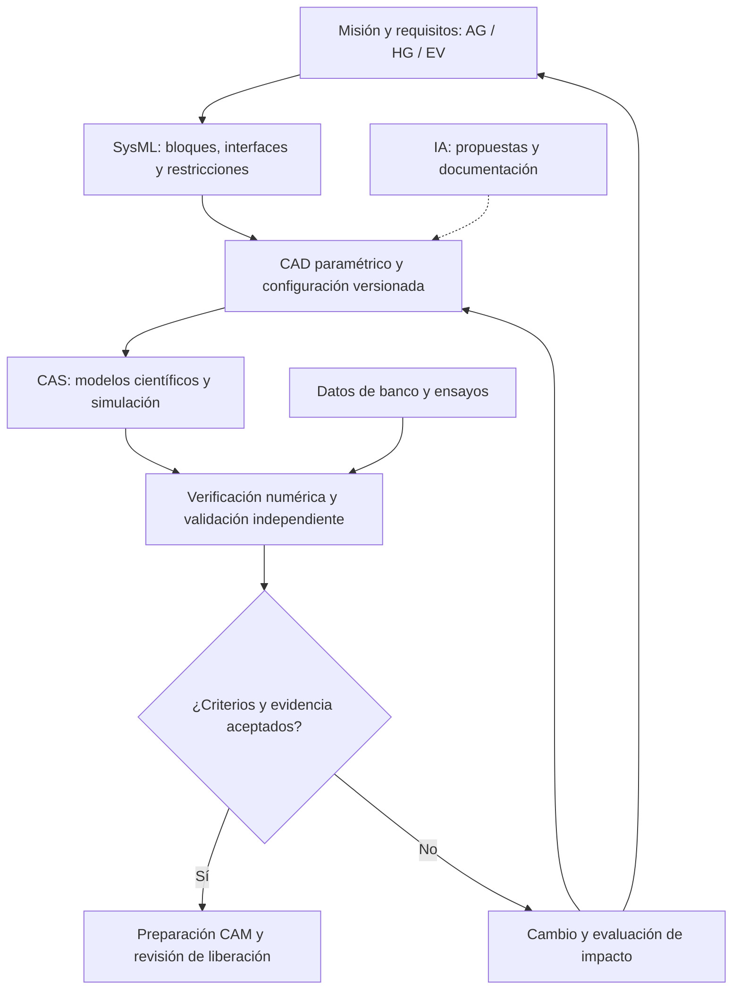
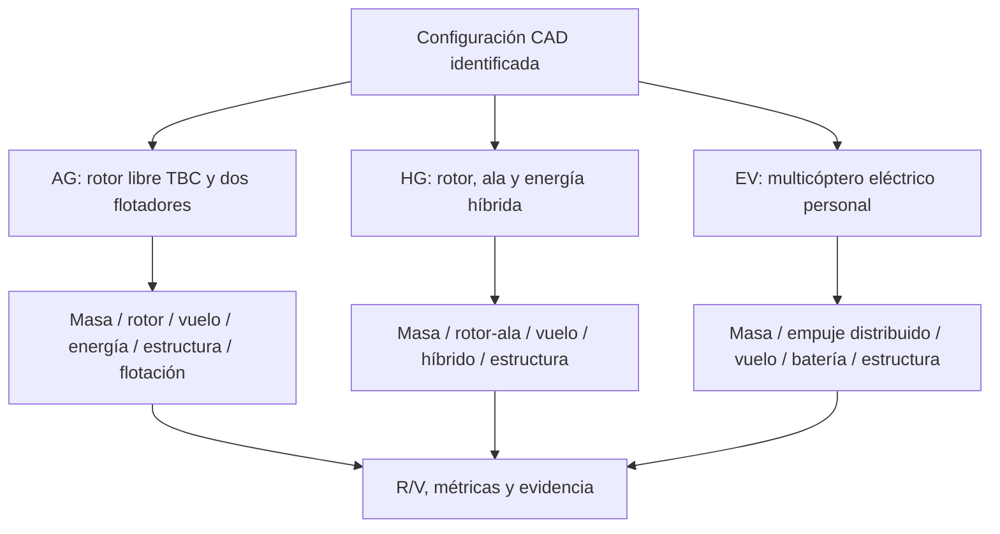
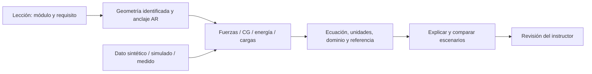
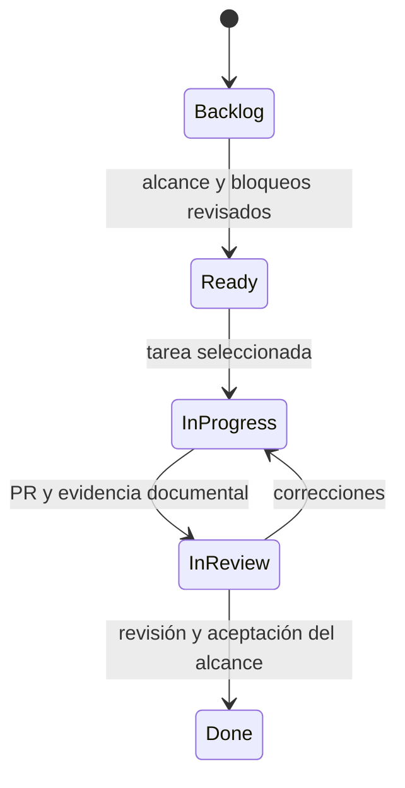

# JFXAI4DIA — Physics-driven industrial design automation

Arquitectura abierta propuesta para requisitos, CAD asistido por IA, análisis físico y verificación. Tres conceptos: giroplano anfibio AG, gyrodyne híbrido HG y eVTOL personal EV.

**Estado: documentación y modelos de alto nivel; [iteración #2](https://github.com/robotics-intelligent-systems/jfxai4dia/issues/2) en progreso.** Las ilustraciones no son CAD dimensionado; integraciones y requisitos siguen propuestos. La entrega no demuestra prestaciones ni conformidad.

## Arquitectura y flujo de ingeniería

CAS realimenta el diseño antes de liberar a CAM. Gemela y canales educativos sirven a ingeniería; sin autoridad de vuelo inicial.

## Conceptos y modelos

| Concepto | Especificación | Diagramas editables |
|---|---|---|
| AG: giroplano anfibio | [AG-R-01…12](docs/requirements/concepts/amphibious-gyroplane.md) | [SysML](MBSE/CAS/Drawio/amphibious-gyroplane-sysml-high-level.drawio) · [Simulación](MBSE/CAS/Drawio/amphibious-gyroplane-scientific-simulation.drawio) |
| HG: gyrodyne híbrido | [HG-R-01…10](docs/requirements/concepts/hybrid-gyrodyne.md) | [SysML](MBSE/CAS/Drawio/hybrid-gyrodyne-sysml-high-level.drawio) · [Simulación](MBSE/CAS/Drawio/hybrid-gyrodyne-scientific-simulation.drawio) |
| EV: eVTOL personal | [EV-R-01…10](docs/requirements/concepts/opentwin-evtol.md) | [SysML](MBSE/CAS/Drawio/opentwin-evtol-sysml-high-level.drawio) · [Simulación](MBSE/CAS/Drawio/opentwin-evtol-scientific-simulation.drawio) |

[Índice de diagramas](docs/diagrams/README.md) · [Requisitos comunes](docs/requirements/README.md) · [Ecuaciones y referencias](docs/simulation/README.md) · [Trazabilidad](docs/simulation/traceability.md).

AG mantiene autorrotación TBC y apoyo terrestre condicional; HG no presupone VTOL; EV no presume tolerancia a pérdida de rotor. Límites se acuerdan con responsables y evidencia, no desde imágenes.

## Capacitación técnica y realidad aumentada

Las [lecciones propuestas](docs/education/ar-technical-training.md) conectan principios teóricos, requisitos y documentación. Los [diagramas AR](MBSE/CAS/Drawio/jfxai4dia-ar-technical-training.drawio) especifican capas, trazabilidad y evaluación; cliente AR pendiente.

## Desarrollo iterativo

[Tarea activa #2](https://github.com/robotics-intelligent-systems/jfxai4dia/issues/2) · [Tablero público](https://github.com/orgs/robotics-intelligent-systems/projects/14).

La iteración entrega Mermaid refactorizado, vistas SysML y modelos científicos draw.io, referencias y capacitación AR. La entrega documental no cierra la campaña de simulación.

**DIA-SIM-002**, siguiente propuesta: fixture AG de flotación estática con CAD dimensionado, masa/CG y criterios aprobados; comprobar equilibrio e inputs inválidos y contrastar datos independientes. **DIA-AR-001**: lección AG con datos sintéticos rotulados y rúbrica del instructor.

## Herramientas y referencias de integración

FreeCAD, OpenModelica, OpenFOAM, CalculiX, Chrono y otras herramientas son candidatos por disciplina. Verificar régimen físico, adaptadores y licencias antes de adoptar la cadena. El [compendio completo](docs/compendium/integration-candidates.md) conserva el análisis histórico de alternativas.
