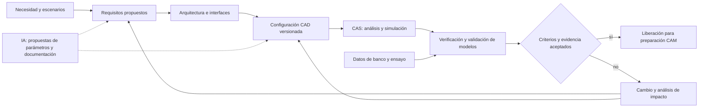
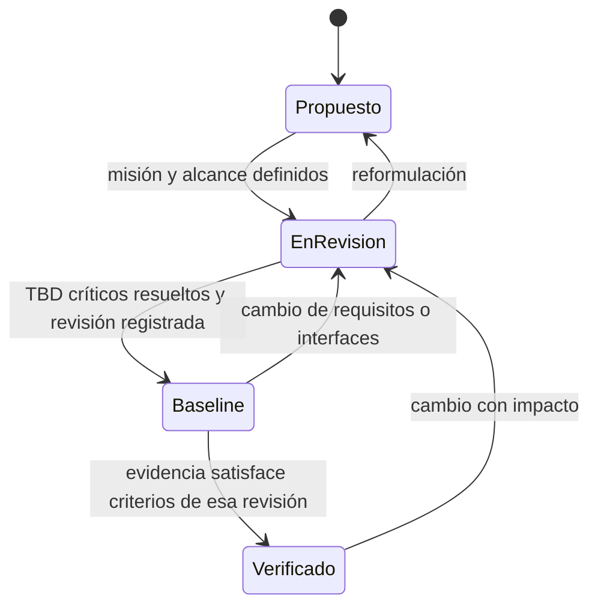

# Ingeniería de requisitos de los conceptos CAD

Revisión B propuesta · 10 de octubre de 2026 · Base documental: commit `1f81c34fc734c5b2200c160c94b7f8baa141d6c1`.

Las tres imágenes de [MBSE/CAD](../../MBSE/CAD) son láminas de concepto, no modelos CAD paramétricos ni resultados de ensayo. Sus textos y elementos visibles sustentan hipótesis de arquitectura; ninguna dimensión, prestación, integración de herramientas o aptitud operacional se considera demostrada. Todos los requisitos de esta carpeta tienen estado **propuesto**.

| Concepto | ID | Especificación y vistas Mermaid | Fuente |
|---|---|---|---|
| Giroplano anfibio con dos flotadores | AG | [Especificación AG](concepts/amphibious-gyroplane.md) | [Lámina](../../MBSE/CAD/twin-float-amphibious-gyroplane.jpg) |
| Taxi aéreo gyrodyne híbrido modular | HG | [Especificación HG](concepts/hybrid-gyrodyne.md) | [Lámina](../../MBSE/CAD/modular-hybrid-gyrodyne-air-taxi.jpg) |
| OpenTwin eVTOL personal | EV | [Especificación EV](concepts/opentwin-evtol.md) | [Lámina](../../MBSE/CAD/opentwin-personal-evtol-digital-twin-concept.jpg) |

## Convenciones y alcance

- `COM-R-nn`: requisito transversal de ingeniería; `AG-R-nn`, `HG-R-nn`, `EV-R-nn`: requisitos de un concepto. Los conceptos son alternativas, no módulos intercambiables entre aeronaves.
- `X-M-nn`: módulo lógico; `X-IF-nn`: interfaz propuesta; `X-V-nn`: actividad de verificación; `X-D-nn`: decisión pendiente. Los IDs de decisiones e interfaces de la lámina Draw.io se conservan bajo el prefijo AG.
- TBD: valor por definir; TBC: hipótesis por confirmar. Un TBD no equivale a cero, aprobación ni cumplimiento. El responsable debe fijar valor, unidades, condiciones y justificación antes de evaluar.
- Cada tabla enlaza requisito → asignación → verificación → criterio. Las relaciones Mermaid describen asignación o flujo de información; no representan cableado, geometría de montaje ni una demostración física.
- La documentación Markdown es la fuente de las vistas Mermaid incluidas. El [Draw.io anfibio](../../MBSE/CAS/Drawio/giroplano-anfibio-requisitos.drawio) se conserva como antecedente Revisión A; su correspondencia R/V se registra en AG. Los Draw.io históricos de marcos generales se conservan. Las nuevas [vistas revisión C](../diagrams/README.md) complementan requisitos y modelos sin sustituir el antecedente ni declarar cumplimiento.

## Hilo de ingeniería

El rótulo histórico MBSE → CAD → CAM → CAS se mantiene como organización del proyecto. Para decidir sobre un concepto, CAS participa antes de liberar a CAM y realimenta requisitos y geometría.

## Requisitos transversales

| ID | Obligación propuesta | Responsable / verificación | Criterio y evidencia de cierre |
|---|---|---|---|
| COM-R-01 | Cada configuración deberá enlazar misión, requisitos aplicables y revisión de arquitectura y CAD. | Sistemas / COM-V-01: inspección | Manifiesto con IDs y revisiones resolubles; ningún requisito aplicable sin asignación y actividad de verificación. |
| COM-R-02 | Cada interfaz deberá declarar origen, destino, magnitudes, unidades, ejes, límites, tolerancias y respuesta ante fallo. | Integración / COM-V-02: revisión ICD | ICD revisado; límites TBD resueltos y prueba de compatibilidad definida antes de integrar. |
| COM-R-03 | Cada ejecución CAS deberá registrar geometría, malla si aplica, parámetros, hipótesis, versiones, entradas y resultados. | Modelado / COM-V-03: reproducción | Segunda ejecución dentro de tolerancia acordada TBD; informe de convergencia y dominio de validez. |
| COM-R-04 | Los modelos deberán evaluarse con datos de validación identificados y separados de los de calibración. | V&V / COM-V-04: análisis | Error, incertidumbre y dominio contrastados con límites TBD acordados; datos insuficientes mantienen el modelo sin validar. |
| COM-R-05 | Las alternativas de IA deberán someterse a los mismos controles de geometría, física y evidencia que las demás alternativas. | Sistemas / COM-V-05: auditoría | Registro de procedencia y revisión; ningún resultado de IA cierra un requisito sin la verificación asignada. |
| COM-R-06 | Todo cambio de módulo, parámetro o requisito deberá evaluar impacto en interfaces, masa, modelos y pruebas. | Configuración / COM-V-06: revisión de cambio | Lista de artefactos afectados, pruebas a repetir y decisión de revisión registrada antes de liberar la nueva base. |

## Contratos de datos propuestos

| Frontera | Contenido obligatorio | Representación candidata |
|---|---|---|
| Requisitos → MBSE | ID, fuente, texto, aplicabilidad, estado, propietario, criterio, verificación, decisiones pendientes | Markdown/tablas; adaptación a Capella por implementar |
| MBSE → CAD | Configuración, módulos e interfaces, parámetros, ejes, unidades, restricciones | Manifiesto + CAD nativo; STEP/BREP según adaptador |
| CAD → CAS | Revisión/hash, geometría derivada, malla, cargas, condiciones y propiedades | Formatos por disciplina con pérdidas de conversión documentadas |
| CAS → V&V | Run ID, entradas, versiones, métricas con unidades, incertidumbre y evidencia | Registro estructurado + informe |
| Telemetría → gemela digital | Configuración, sello temporal, reloj, calibración, unidades, calidad y origen | Esquema por definir; canal de ingeniería sin autoridad de mando inicial |

CPACS puede evaluarse para metadatos aeronáuticos; su cobertura para rotores, flotadores y propulsión distribuida requiere comprobarse. IFC pertenece a la rama BIM del compendio y no se impone a estos tres conceptos. Las herramientas del README y de las láminas son candidatas; su selección exige demostrar soporte del caso físico y del intercambio requerido.

## Madurez y estados

G0: misión y decisiones de alcance. G1: requisitos cuantificados e ICD. G2: modelos correlacionados y bancos. G3: ensayos integrados según plan aprobado. G4: revisión de evidencia. Ningún hito está declarado completado por esta documentación; la verificación de requisitos tampoco demuestra por sí sola que la misión del usuario sea adecuada.

Las decisiones comunes de jurisdicción/categoría, límites de masa, entorno, reservas, cargas y tolerancias de correlación deberán resolverse con responsables identificados. No se selecciona aquí una base regulatoria ni se afirma conformidad.

## Complementos revisión C

[SysML y simulación](../diagrams/README.md) · [Modelos y referencias](../simulation/README.md) · [Trazabilidad](../simulation/traceability.md) · [Capacitación AR](../education/ar-technical-training.md).
