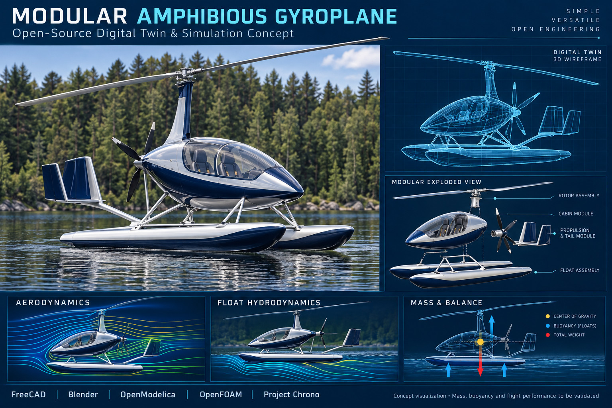
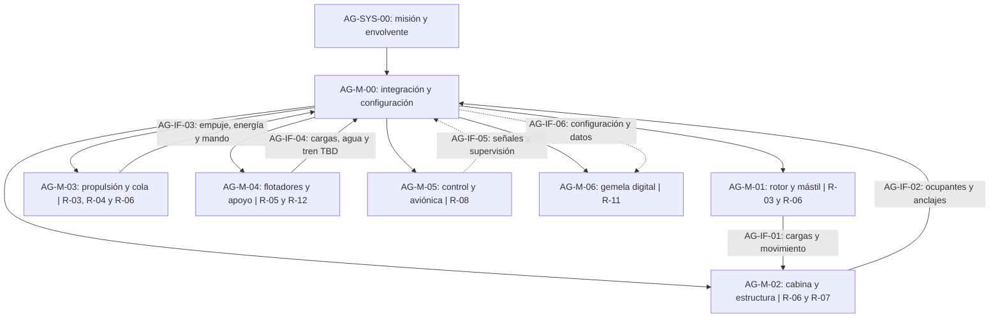

# AG — Giroplano anfibio modular

[Índice y reglas comunes](../README.md) · Revisión B propuesta · Todos los requisitos: propuestos.

## Fuente, hipótesis y misión

La lámina muestra rotor y mástil, cabina con dos asientos aparentes, hélice posterior, cola y dos flotadores. La autorrotación es una hipótesis TBC; no se confirma un sistema de prerrotación ni operación VTOL. No se observa tren terrestre: el alcance anfibio agua/tierra debe cerrarse mediante AG-D-03. La misión, ocupación y energía permanecen pendientes.

Esta especificación migra los R-01…R-12 y V-01…V-12 del [Draw.io Revisión A](../../../MBSE/CAS/Drawio/giroplano-anfibio-requisitos.drawio) a AG-R-01…AG-R-12 y AG-V-01…AG-V-12, respectivamente, sin cambiar su numeración ni obligación. SYS-00 corresponde a AG-SYS-00: misión aprobada en agua y, si se confirma AG-D-03, en tierra, con vuelo, flotación, control y mantenimiento modular dentro de una envolvente demostrada.

## Asignación modular

Los IDs R abreviados en la figura pertenecen al prefijo AG. AG-M-00 asume R-01, R-02, R-09 y R-10; R-03 se comparte entre rotor y propulsión. La gemela recibe datos para ingeniería; no se le asigna autoridad de mando.

## Requisitos y verificación

Aplican además COM-R-01…COM-R-06. Los responsables AG-V-01…12 son, en orden: sistemas, integración, dinámica de vuelo, propulsión, hidrodinámica, estructuras, factores humanos, control y aviónica, mantenimiento, seguridad/conformidad, modelado e integración.

| ID | Obligación y parámetros pendientes | Asignación | Verificación | Criterio y evidencia de cierre |
|---|---|---|---|---|
| AG-R-01 | Deberá definir ocupación, carga, duración, alcance, emplazamientos y modos operativos. Parámetros: ocupantes [n], carga [kg], autonomía [min], alcance [km]: TBD. | AG-M-00 | AG-V-01: revisión de misión y escenarios | CONOPS aprobado con ocupación, carga, duración, alcance y operación agua/tierra definidos. |
| AG-R-02 | Deberá mantener masa y centro de gravedad dentro de límites aprobados en todas las configuraciones y consumos. Parámetros: MTOM [kg], CG [m], márgenes: TBD. | AG-M-00 | AG-V-02: análisis y pesaje | Masa y CG de cada caso de carga y consumo dentro de límites TBD aprobados; informe y pesaje. |
| AG-R-03 | Deberá demostrar sustentación, estabilidad y control en la envolvente de giroplano adoptada, incluidas transiciones de despegue y aterrizaje. Velocidad [m/s], RPM, viento y distancias [m]: TBD. | AG-M-01 | AG-V-03: modelos y ensayos progresivos | Envolvente, márgenes y tolerancia de correlación TBD satisfechos; campaña progresiva documentada. |
| AG-R-04 | Deberá proporcionar empuje y reserva energética para la misión, con supervisión térmica y respuesta definida ante fallos. Potencia [kW], energía, refrigeración y tipo de motor: TBD. | AG-M-03 | AG-V-04: banco y análisis | Ciclo de misión y reserva TBD cubiertos sin exceder límites térmicos TBD; curvas de banco y balance. |
| AG-R-05 | Deberá sostener las condiciones de carga y conservar estabilidad a flote y durante maniobras en la envolvente acuática aprobada. Reserva de flotabilidad, oleaje, calado y estanqueidad: TBD. | AG-M-04 | AG-V-05: análisis y ensayos acuáticos | Estabilidad, reserva de flotabilidad, oleaje y daño definidos TBD satisfechos; balance y ensayos acuáticos. |
| AG-R-06 | Deberá transmitir cargas de rotor, propulsión y flotadores mediante uniones verificables, considerando fatiga y ambiente húmedo. Cargas, vida, corrosión y materiales: TBD. | AG-M-01 / AG-M-02 / AG-M-03 | AG-V-06: análisis, inspección y ensayos | Casos de carga, márgenes, fatiga y ambiente húmedo acordados TBD satisfechos; análisis e inspección. |
| AG-R-07 | Deberá permitir acceso, visibilidad, sujeción y evacuación para los ocupantes definidos, incluidos escenarios de emergencia en agua. Ergonomía y tiempos de evacuación: TBD. | AG-M-02 | AG-V-07: maqueta y demostración | Población y escenarios definidos; acceso, visibilidad y evacuación cumplen criterios TBD; demostración. |
| AG-R-08 | Deberá permitir mando y supervisión de vuelo, propulsión y condición anfibia, con indicaciones inequívocas y modos degradados definidos. Sensores, alimentación, alertas y latencia: TBD. | AG-M-05 | AG-V-08: integración y fallos simulados | Latencias, alertas y respuestas degradadas TBD cumplidas en integración y fallos simulados. |
| AG-R-09 | Deberá permitir sustitución de módulos con interfaces documentadas, configuración identificable e inspección posterior. Tiempo de intervención y medios: TBD. | AG-M-00 | AG-V-09: inspección y demostración | ICD y configuración identificados; sustitución dentro de tiempo TBD con inspección funcional conforme. |
| AG-R-10 | Deberá trazar peligros a medidas y evidencias: pérdida de empuje, entrada de agua, inestabilidad, contacto con hélice/rotor y evacuación. Base de conformidad: D-02, pendiente. | AG-M-00 | AG-V-10: revisión de riesgos y evidencias | AG-D-02 resuelta; peligros trazados y tratamiento de riesgos residuales revisado según proceso acordado. |
| AG-R-11 | Deberá mantener modelos de masa, vuelo, estructura y flotación vinculados a una configuración y datos de validación trazables. Fidelidad, incertidumbre y frecuencia de actualización: TBD. | AG-M-06 | AG-V-11: correlación y reproducibilidad | Error y dominio TBD cumplidos con modelos versionados y datos separados para calibración/validación. |
| AG-R-12 | Si D-03 incluye tierra, deberá incorporar una solución de apoyo, frenado y transición compatible con flotadores y centrado. Tren, terreno y cargas de aterrizaje: TBD. | AG-M-04 | AG-V-12: análisis y demostración | AG-D-03 cerrada; si aplica tierra, apoyo, frenado y transición cumplen cargas y escenarios TBD. |

## Interfaces

AG-IF-01…06 conservan la correspondencia IF-01…06 del Draw.io. Cada ICD aplicará COM-R-02. AG-IF-01 declara cargas y ejes del rotor; AG-IF-02, sujeciones y envolvente de ocupantes; AG-IF-03, empuje, energía y mando; AG-IF-04, cargas de flotadores, estanqueidad y apoyo terrestre condicional; AG-IF-05, señales, alimentación, tiempo y degradación; AG-IF-06, versiones de modelos, telemetría y resultados. Límites y tolerancias: TBD; responsable de consolidación: integración con cada disciplina propietaria.

## Decisiones abiertas

| ID | Decisión | Responsable propuesto | Cierre requerido |
|---|---|---|---|
| AG-D-01 | Misión, ocupación y carga útil | Sistemas | Antes de G1; CONOPS |
| AG-D-02 | Jurisdicción y categoría | Conformidad | Antes de fijar base de requisitos |
| AG-D-03 | Operación terrestre y tren | Integración | Antes de cerrar arquitectura; si se excluye tierra, revisar denominación anfibia y aplicabilidad de AG-R-12 |
| AG-D-04 | Fuente de energía y motor | Propulsión | Antes de balances de masa y misión |
| AG-D-05 | Régimen del rotor y prerrotación | Dinámica de vuelo | Antes de cerrar AG-R-03 y modelos |

## Cadena de análisis propuesta

FreeCAD: parámetros y uniones; Blender: visualización; OpenModelica: energía y sistemas; OpenFOAM: fluidos; Project Chrono: dinámica multicuerpo. La evidencia requerida incluye masa/CG, rotor/propulsión, estructura y flotación. Los adaptadores y modelos para autorrotación, superficie libre e interacción con flotadores deberán demostrarse antes de usar resultados para cerrar requisitos.

## Vistas revisión C: SysML, simulación y capacitación

[SysML editable](../../../MBSE/CAS/Drawio/amphibious-gyroplane-sysml-high-level.drawio) · [Modelos científicos](../../../MBSE/CAS/Drawio/amphibious-gyroplane-scientific-simulation.drawio) · [Ecuaciones y referencias](../../simulation/README.md) · [Capacitación AR](../../education/ar-technical-training.md).

Se conservan obligaciones, IDs y criterios de revisión B; las vistas proponen asignaciones y actividades, sin declarar satisfacción ni verificación.
