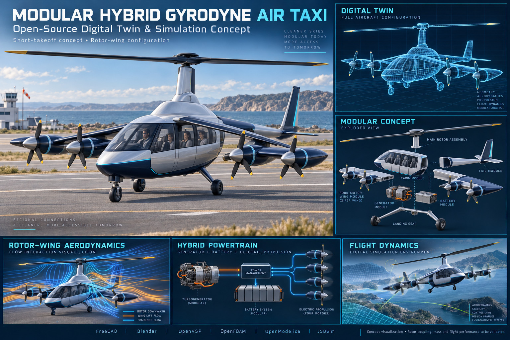
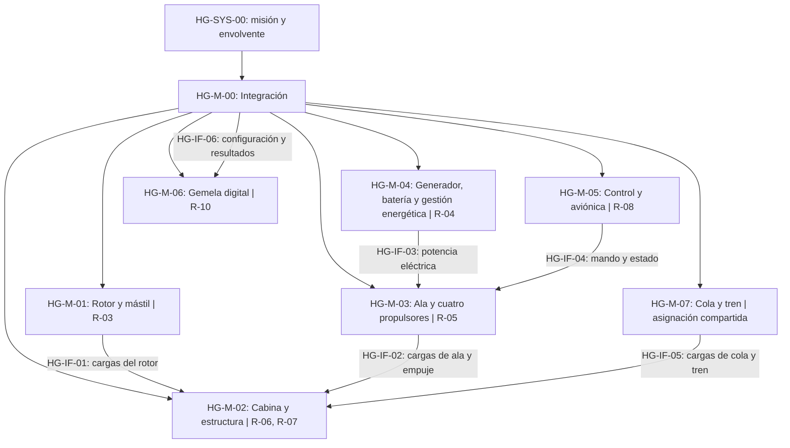
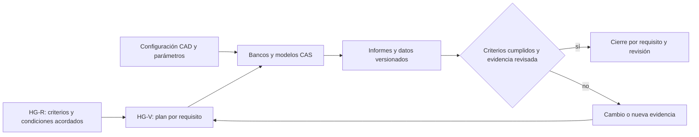

# HG — Taxi aéreo gyrodyne híbrido modular

[Índice y reglas comunes](../README.md) · Revisión B propuesta · Todos los requisitos: propuestos.

## Fuente e hipótesis

La lámina rotula un taxi aéreo de despegue corto con rotor y ala, cuatro propulsores, generador, batería, cabina, cola y tren. La arquitectura híbrida procede del texto de la lámina; no hay balance energético ni prestaciones demostradas. La denominación gyrodyne no determina por sí sola cuándo el rotor recibe potencia: ese régimen y la transición quedan TBC. No se asume VTOL.

HG-SYS-00: el sistema deberá ejecutar la misión acordada dentro de una envolvente demostrada, con configuración modular identificada y evidencia trazable. La gemela digital es un sistema de apoyo a ingeniería y no un controlador de vuelo inicial.

## Asignación modular

Los IDs R abreviados en la vista pertenecen a HG. HG-M-00 coordina los requisitos asignados a integración y aplica COM-R-01…COM-R-06. Las asignaciones compartidas de cargas y control requieren revisión entre disciplinas.

## Requisitos y verificación

| ID | Obligación propuesta | Asignación | Verificación y responsable propuesto | Criterio y evidencia de cierre |
|---|---|---|---|---|
| HG-R-01 · Misión | El sistema deberá completar los segmentos de la misión de taxi aéreo definida con ocupación, carga útil, duración, alcance, emplazamientos y reserva registrados. | HG-M-00 | HG-V-01: Sistemas / revisión | CONOPS con ocupantes [n], carga [kg], alcance [km], duración [min] y reserva TBD aprobado. |
| HG-R-02 · Masa y centrado | Cada configuración y estado de consumo deberá permanecer dentro de límites de masa y CG aprobados. | HG-M-00 | HG-V-02: Integración / análisis y pesaje | MTOM [kg] y envolvente CG [m] TBD cumplidos en todos los casos de misión y módulos. |
| HG-R-03 · Rotor y transición | El rotor y el ala deberán proporcionar sustentación y control en los regímenes de potencia y transición seleccionados. | HG-M-01 | HG-V-03: Dinámica de vuelo / análisis y ensayo progresivo | Régimen TBC, envolvente [m/s], RPM, viento y distancia de despegue [m] TBD cerrados; modelos correlacionados y evidencia de transición. |
| HG-R-04 · Energía híbrida | El sistema energético deberá suministrar la potencia de los segmentos aprobados y su reserva sin exceder límites eléctricos ni térmicos. | HG-M-04 | HG-V-04: Propulsión / banco y análisis | Balance de potencia [kW], energía [kWh], combustible [kg] si aplica, eficiencia y temperatura [K] TBD dentro de límites; curvas y ciclo de misión. |
| HG-R-05 · Propulsión distribuida | La integración ala-propulsores deberá mantener el empuje y la autoridad de control requeridos en estados normales y fallos definidos. | HG-M-03 | HG-V-05: Propulsión y control / banco y simulación | Mapa de empuje [N], asimetría, fallos y márgenes TBD satisfechos; interacciones rotor-ala-propulsores evaluadas. |
| HG-R-06 · Estructura y apoyo | Estructura, uniones, cola y tren deberán soportar las cargas de vuelo, vibración y operación terrestre de la configuración aprobada. | HG-M-02 | HG-V-06: Estructuras / análisis, inspección y ensayo | Cargas [N], momentos [N m], vida y márgenes TBD satisfechos en rotor, ala, módulos y tren; informe de casos. |
| HG-R-07 · Factores humanos | La cabina deberá permitir acceso, sujeción, visibilidad y evacuación de la población de ocupantes aprobada. | HG-M-02 | HG-V-07: Factores humanos / demostración | Ocupación TBC y criterios de accesibilidad, visibilidad y tiempo [s] TBD cumplidos en maqueta. |
| HG-R-08 · Control y seguridad | El sistema de mando deberá supervisar propulsión y energía y ejecutar las respuestas degradadas definidas para los peligros de misión. | HG-M-05 | HG-V-08: Control y seguridad / integración y revisión | Latencias [ms], alertas, respuestas y aceptación de riesgos TBD cumplidas; fallos y trazas documentados. |
| HG-R-09 · Modularidad | La sustitución de módulos deberá preservar identificación, compatibilidad y funcionamiento de la configuración. | HG-M-00 | HG-V-09: Mantenimiento / inspección y demostración | ICD completos, tiempo [min] y herramientas TBD; prueba posterior conforme y nuevo balance de masa/CG. |
| HG-R-10 · Gemela digital | La gemela deberá representar masa, energía, dinámica e interacción rotor-ala-propulsores para cada revisión identificada. | HG-M-06 | HG-V-10: Modelado / correlación y reproducción | Error, incertidumbre y dominio TBD satisfechos con datos independientes; COM-R-03 y COM-R-04 cumplidos. |

## Interfaces propuestas

Integración consolida cada ICD con los propietarios de los módulos de origen y destino. Las flechas indican el contenido de la interfaz; no implican que el intercambio sea exclusivamente unidireccional.

| ID | Frontera | Contenido pendiente |
|---|---|---|
| HG-IF-01 | HG-M-01 → HG-M-02 | cargas del rotor; unidades, ejes, límites, tolerancias, fallos y aceptación TBD según COM-R-02. |
| HG-IF-02 | HG-M-03 → HG-M-02 | cargas de ala y empuje; unidades, ejes, límites, tolerancias, fallos y aceptación TBD según COM-R-02. |
| HG-IF-03 | HG-M-04 → HG-M-03 | potencia eléctrica; unidades, ejes, límites, tolerancias, fallos y aceptación TBD según COM-R-02. |
| HG-IF-04 | HG-M-05 → HG-M-03 | mando y estado; unidades, ejes, límites, tolerancias, fallos y aceptación TBD según COM-R-02. |
| HG-IF-05 | HG-M-07 → HG-M-02 | cargas de cola y tren; unidades, ejes, límites, tolerancias, fallos y aceptación TBD según COM-R-02. |
| HG-IF-06 | HG-M-00 → HG-M-06 | configuración y resultados; unidades, ejes, límites, tolerancias, fallos y aceptación TBD según COM-R-02. |

## Decisiones abiertas

| ID | Decisión | Responsable propuesto | Momento de cierre |
|---|---|---|---|
| HG-D-01 | Misión, ocupación y despegue corto | Sistemas | G0 para misión/categoría; G1 para arquitectura y límites. |
| HG-D-02 | Jurisdicción y categoría | Conformidad | G0 para misión/categoría; G1 para arquitectura y límites. |
| HG-D-03 | Potencia al rotor y transiciones | Dinámica de vuelo | G0 para misión/categoría; G1 para arquitectura y límites. |
| HG-D-04 | Topología híbrida, combustible y reserva | Propulsión | G0 para misión/categoría; G1 para arquitectura y límites. |
| HG-D-05 | Distribución eléctrica y fallos comunes | Control y propulsión | G0 para misión/categoría; G1 para arquitectura y límites. |

Los valores TBD de cada requisito se cierran en G1 por su responsable antes de baselinar y ejecutar una evaluación de aceptación. No se asignan cifras de rendimiento a partir de la imagen.

## Cadena de análisis propuesta

FreeCAD/Blender: geometría y visualización; OpenVSP: candidato para geometría/análisis conceptual; OpenFOAM: fluidos; OpenModelica: energía; JSBSim: candidato para dinámica. El uso en rotor-ala y transición exige comprobar modelos, acoplamiento y dominio; una herramienta de ala fija no demuestra por sí sola la dinámica de un gyrodyne.

## Flujo de verificación

