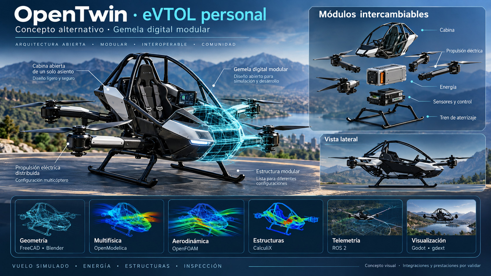
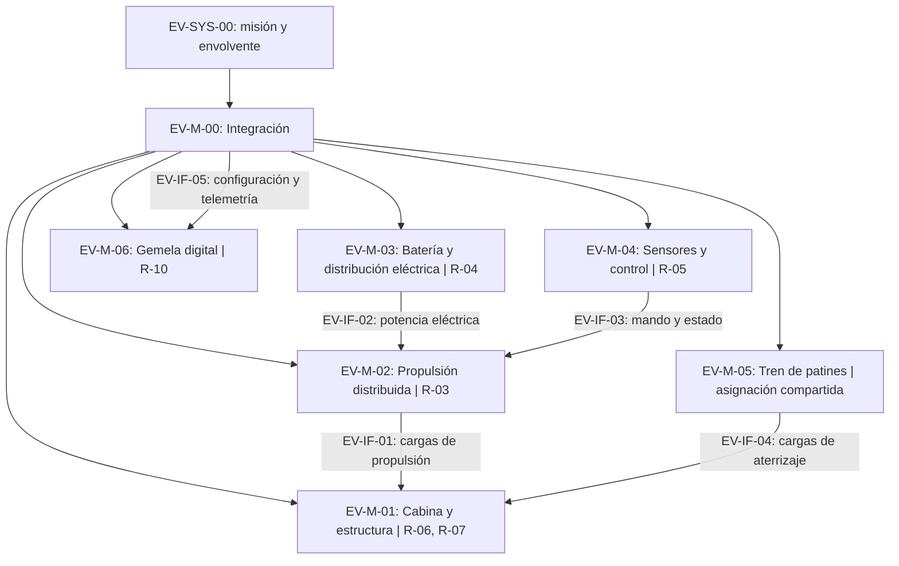
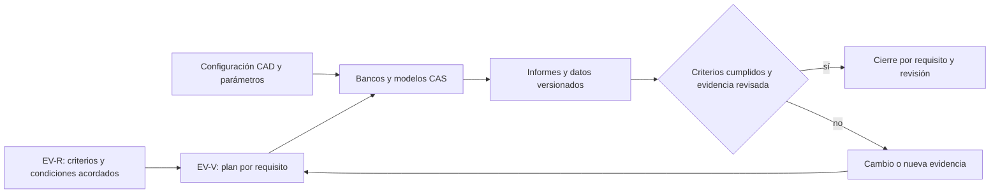

# EV — OpenTwin eVTOL personal

[Índice y reglas comunes](../README.md) · Revisión B propuesta · Todos los requisitos: propuestos.

## Fuente e hipótesis

La lámina declara cabina abierta de un asiento, configuración multicóptero, propulsión eléctrica distribuida, energía, sensores/control y tren de patines. La cantidad definitiva de rotores, batería, redundancia y prestaciones no se fija a partir de la imagen. El despegue vertical es un objetivo propuesto, pendiente de verificación.

EV-SYS-00: el sistema deberá ejecutar la misión acordada dentro de una envolvente demostrada, con configuración modular identificada y evidencia trazable. La gemela digital es un sistema de apoyo a ingeniería y no un controlador de vuelo inicial.

## Asignación modular

Los IDs R abreviados en la vista pertenecen a EV. EV-M-00 coordina los requisitos asignados a integración y aplica COM-R-01…COM-R-06. Las asignaciones compartidas de cargas y control requieren revisión entre disciplinas.

## Requisitos y verificación

| ID | Obligación propuesta | Asignación | Verificación y responsable propuesto | Criterio y evidencia de cierre |
|---|---|---|---|---|
| EV-R-01 · Misión | El sistema deberá completar la misión personal aprobada de despegue, estacionario, desplazamiento y aterrizaje con reserva definida. | EV-M-00 | EV-V-01: Sistemas / revisión | Ocupación TBC, carga [kg], duración [min], radio [km], viento [m/s] y reserva TBD definidos en CONOPS. |
| EV-R-02 · Masa y centrado | Cada configuración y estado energético deberá mantenerse dentro de masa y CG aprobados. | EV-M-00 | EV-V-02: Integración / análisis y pesaje | MTOM [kg] y límites CG [m] TBD cumplidos con ocupante, batería y módulos; informe y pesaje. |
| EV-R-03 · Sustentación y control | La propulsión distribuida deberá proporcionar sustentación y autoridad de control para los segmentos y estados degradados seleccionados. | EV-M-02 | EV-V-03: Dinámica y propulsión / banco y análisis | Número de rotores TBC, empuje [N], márgenes, envolvente y fallos TBD definidos y satisfechos; interacción entre rotores evaluada. |
| EV-R-04 · Energía y temperatura | La batería y distribución deberán cubrir misión y reserva dentro de sus límites eléctricos, térmicos y de estado energético. | EV-M-03 | EV-V-04: Energía / banco y análisis | Potencia [kW], energía utilizable [kWh], tensión [V], corriente [A], temperatura [K] y estado de carga [%] TBD cumplidos en ciclo de misión. |
| EV-R-05 · Control y sensado | El control deberá detectar las condiciones de fallo definidas y producir mando, alertas y respuesta degradada conforme a la arquitectura seleccionada. | EV-M-04 | EV-V-05: Control / integración y fallos simulados | Latencias [ms], disponibilidad, pérdida de sensor/comunicación/actuador y respuesta TBD satisfechas; registros sincronizados. |
| EV-R-06 · Estructura y aterrizaje | Cabina, brazos, uniones y patines deberán transmitir cargas de propulsión, ocupante y aterrizaje aprobadas. | EV-M-01 | EV-V-06: Estructuras / análisis y ensayo | Cargas [N], momentos [N m], impacto, vida y márgenes TBD satisfechos; asignación compartida con EV-M-05. |
| EV-R-07 · Ocupante y entorno | La cabina abierta deberá permitir sujeción, acceso, visibilidad y evacuación dentro del entorno de operación aprobado. | EV-M-01 | EV-V-07: Factores humanos / demostración | Población, exposición ambiental, separación de rotores y tiempo de evacuación [s] TBD evaluados en maqueta. |
| EV-R-08 · Modularidad | La sustitución de energía, propulsión o control deberá conservar compatibilidad, identificación y funcionamiento de la configuración. | EV-M-00 | EV-V-08: Mantenimiento / inspección y demostración | ICD, tiempo [min] y herramientas TBD definidos; inspección y prueba posteriores conformes; impacto masa/CG evaluado. |
| EV-R-09 · Seguridad | Los peligros de pérdida de sustentación, fallos eléctricos/térmicos y contacto con rotores deberán vincularse a requisitos y evidencias de mitigación. | EV-M-00 | EV-V-09: Seguridad / revisión | Escenarios, criterios de riesgo y respuestas TBD revisados; no se presume tolerancia a fallo de un rotor. |
| EV-R-10 · Gemela digital | La gemela deberá vincular geometría, energía, estructura, dinámica y telemetría a una revisión de configuración. | EV-M-06 | EV-V-10: Modelado / correlación y reproducción | Error, incertidumbre, sincronización [ms] y dominio TBD satisfechos; calibración separada de validación. |

## Interfaces propuestas

Integración consolida cada ICD con los propietarios de los módulos de origen y destino. Las flechas indican el contenido de la interfaz; no implican que el intercambio sea exclusivamente unidireccional.

| ID | Frontera | Contenido pendiente |
|---|---|---|
| EV-IF-01 | EV-M-02 → EV-M-01 | cargas de propulsión; unidades, ejes, límites, tolerancias, fallos y aceptación TBD según COM-R-02. |
| EV-IF-02 | EV-M-03 → EV-M-02 | potencia eléctrica; unidades, ejes, límites, tolerancias, fallos y aceptación TBD según COM-R-02. |
| EV-IF-03 | EV-M-04 → EV-M-02 | mando y estado; unidades, ejes, límites, tolerancias, fallos y aceptación TBD según COM-R-02. |
| EV-IF-04 | EV-M-05 → EV-M-01 | cargas de aterrizaje; unidades, ejes, límites, tolerancias, fallos y aceptación TBD según COM-R-02. |
| EV-IF-05 | EV-M-00 → EV-M-06 | configuración y telemetría; unidades, ejes, límites, tolerancias, fallos y aceptación TBD según COM-R-02. |

## Decisiones abiertas

| ID | Decisión | Responsable propuesto | Momento de cierre |
|---|---|---|---|
| EV-D-01 | Misión, ocupante y entorno | Sistemas | G0 para misión/categoría; G1 para arquitectura y límites. |
| EV-D-02 | Jurisdicción y categoría | Conformidad | G0 para misión/categoría; G1 para arquitectura y límites. |
| EV-D-03 | Número de rotores y arquitectura de control | Dinámica y control | G0 para misión/categoría; G1 para arquitectura y límites. |
| EV-D-04 | Batería, reserva y gestión térmica | Energía | G0 para misión/categoría; G1 para arquitectura y límites. |
| EV-D-05 | Fallos tolerados y respuesta de aterrizaje | Seguridad y control | G0 para misión/categoría; G1 para arquitectura y límites. |

Los valores TBD de cada requisito se cierran en G1 por su responsable antes de baselinar y ejecutar una evaluación de aceptación. No se asignan cifras de rendimiento a partir de la imagen.

## Cadena de análisis propuesta

FreeCAD/Blender: geometría y visualización; OpenModelica: sistemas; OpenFOAM: aerodinámica; CalculiX: estructuras; ROS 2: candidato de telemetría; Godot/gdext: visualización. Los canales de telemetría no adquieren autoridad de vuelo por figurar en la lámina. Se requiere demostrar modelos de multicóptero y adaptadores antes de cerrar requisitos.

## Flujo de verificación

